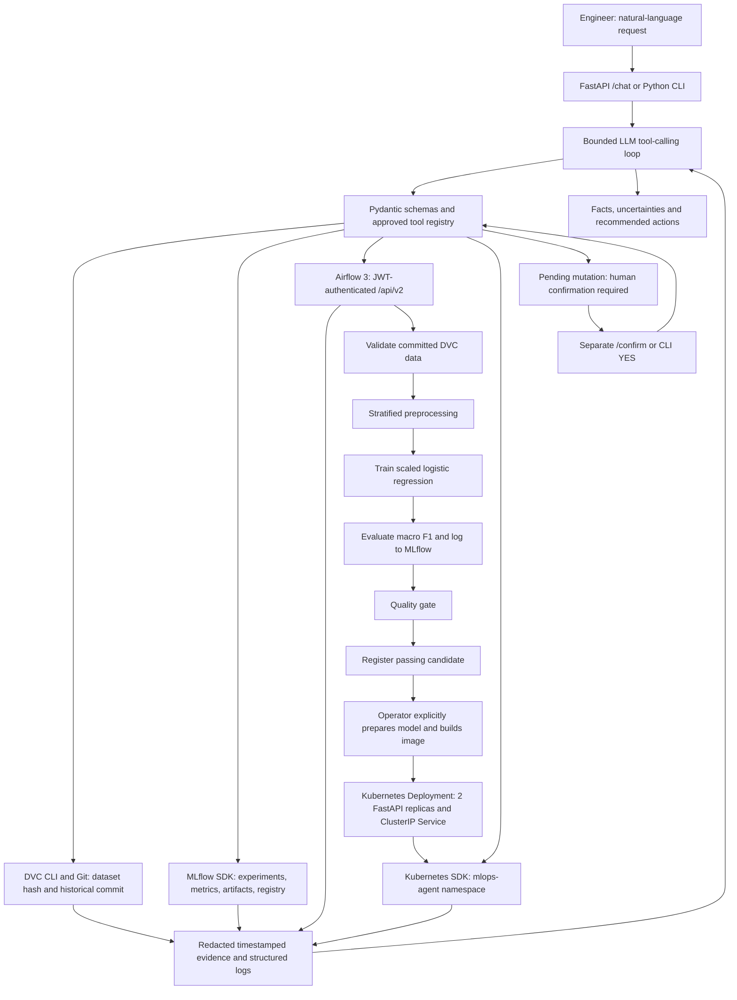

# Architecture

## Boundaries and evidence

The LLM chooses tools dynamically from their JSON schemas. Python validates
inputs and dispatches fixed functions; the model cannot execute Python, a shell,
arbitrary DVC commands, arbitrary Kubernetes patches or a confirmation action.
`agent/orchestrator.py` bounds model turns and tool calls per turn. Each result
contains an evidence ID, request ID, source, observation time, duration and explicit
status. Responses retain the evidence even if a later LLM call fails.

`agent/logging.py` redacts configured secrets, credential fields, assignment forms
and common token patterns. Tool outputs are untrusted data. Errors remain explicit;
if every attempted tool fails, a deterministic incomplete response is returned
without a further LLM call that could invent operational results. Partial failures
remain attached and cause an incomplete response. The model must cite evidence;
semantic synthesis still needs review (there is no formal proof of every sentence).

## Tool definitions and permissions

Exact argument schemas/descriptions: [tool-definitions.json](docs/tool-definitions.json).

| Module | Tools | Permission |
|---|---|---|
| DVC | `dvc_list_datasets`, `dvc_dataset_version`, `dvc_compare_versions`, `dvc_status`, `dvc_reproduction` | Fixed read commands. Revision resolves to a Git commit. Reproduction returns instructions, not a checkout. |
| MLflow | `mlflow_list_experiments`, `mlflow_list_runs`, `mlflow_run_details`, `mlflow_best_run`, `mlflow_compare_runs`, `mlflow_registry` | Read-only SDK calls. Bounded search; metric/direction explicit. |
| Airflow | `airflow_list_dags`, `airflow_list_runs`, `airflow_run_status`, `airflow_tasks`, `airflow_task_log`, `airflow_trigger` | JWT required. Trigger restricted to `APPROVED_DAGS` and separately confirmed by a human. |
| Kubernetes | `kubernetes_workloads`, `kubernetes_services`, `kubernetes_pod_logs`, `kubernetes_events`, `kubernetes_app_version`, `kubernetes_restart` | Approved namespace only. Pods must belong to iris-api. Only iris-api can be restarted, after separate confirmation. |

Pydantic forbids extra fields, constrains identifiers and bounds list/log sizes.
Confirmation records bind exact validated arguments to a request, expire in five
minutes, and are removed before use. A model-supplied `confirmed=true` is rejected.
Kubernetes RBAC remains an independent enforcement boundary: the provided read-only
Role cannot mutate a cluster even when application confirmation is approved.

## Training, lineage and serving

`training/train.py` implements the stages used by both `dvc.yaml` and
`dags/training_pipeline.py`. Validation verifies finite values, class/schema
constraints, raw MD5, DVC pointer and committed pointer at HEAD. A fixed
stratified test split is held out; the scaler fits only on training data.
MLflow records `dataset.git_commit`, `dataset.dvc_hash`, path, rows,
`airflow.run_id`, metrics, parameters, artifacts and gate result. Historical
provenance is read from that recorded commit, not inferred from today's HEAD.

Airflow tasks have explicit dependencies, one retry, a ten-second retry interval,
execution deadlines and per-run shared work directories. Validation failure blocks
downstream tasks. A failed F1 threshold marks the run's quality gate failed and
prevents registration. Successful registration still does not deploy anything.

An operator selects a passed run using `scripts/promote_model.py`, builds the
inference image and explicitly applies the manifests. The image contains that
model plus its metadata. `/version` exposes the running run ID/hash. The agent
reads it through the Kubernetes Service proxy to distinguish a candidate from
the model actually serving. `/healthz` is process liveness; `/readyz` additionally
requires model and provenance. The Service routes only to ready Pods.

## Deployment model and limitations

Compose provides loopback-only MLflow and Airflow services with persistent volumes;
kind supplies the local cluster. Kubernetes uses two desired replicas, resource
requests/limits, non-root execution and a non-sensitive ConfigMap. Local services
are development deployments, not an HA multi-user control plane. The agent HTTP
server is loopback-only and has no application authentication. Its confirmation
store is in memory and must remain in a single process.

CI tests external integrations with mocks and no secrets. The demonstration report
uses exported real service responses and real LLM conversations. Ordinary CI cannot
prove a running cluster is healthy; it verifies adapter and control-flow behavior.
Retraining is never inferred solely from model ranking or a deployment failure:
it requires a configured freshness policy, failed quality gate or supplied
degradation evidence. Without these, necessity remains uncertain.
