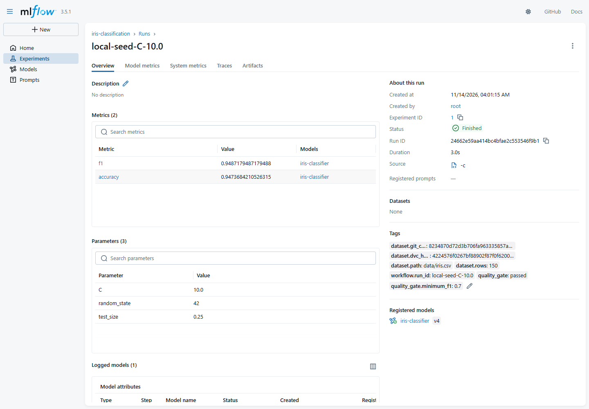
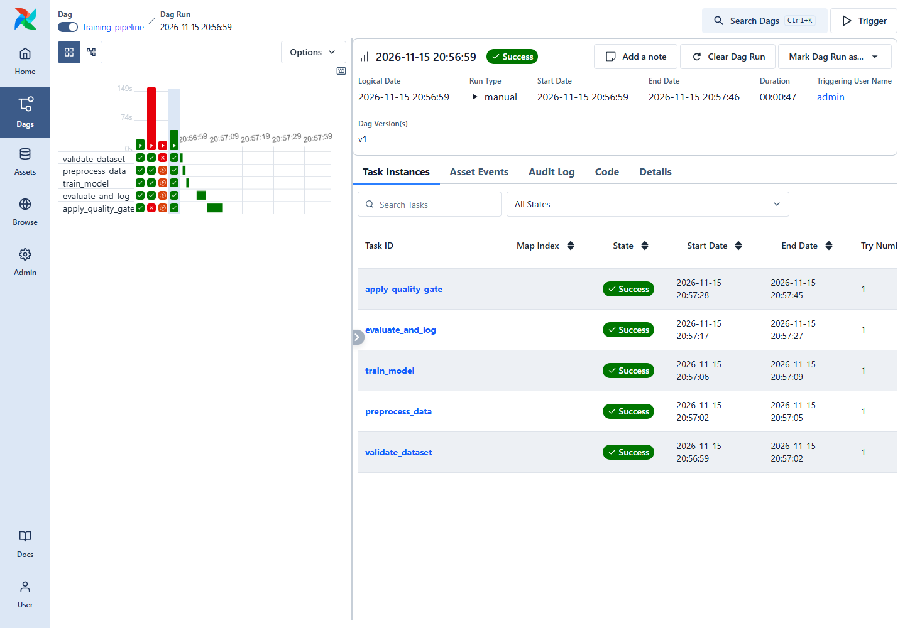
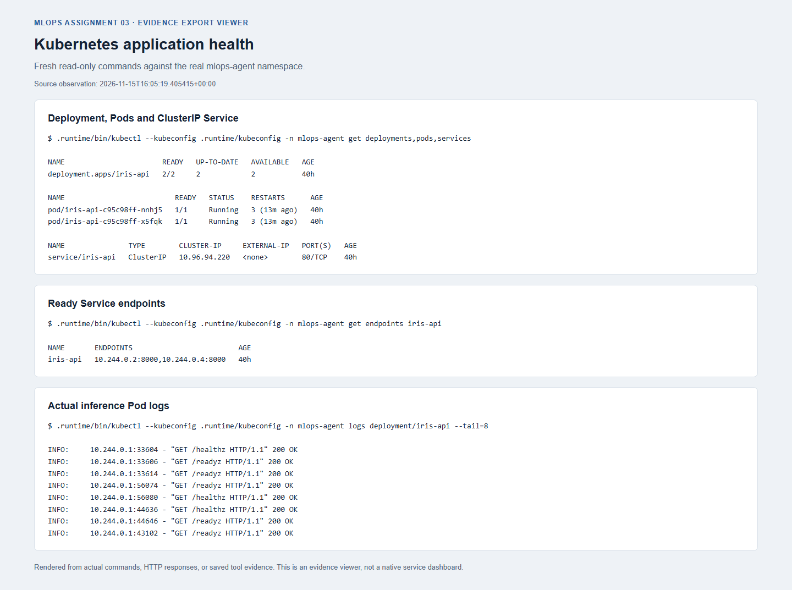

# Technical report: MLOps AI Agent

## Final submission validation

The final source passes **36 automated tests**, Ruff lint/format checks, DAG
compilation, dependency consistency and Compose configuration validation.
[Final real-service verification](evidence/final-submission-verification.json)
finished with `status=passed`, including a real LLM conversation using DVC,
MLflow, Airflow and Kubernetes, after the configuration fixes. This last check
read existing workflows without triggering training. The
[final historical checkout](evidence/final-submission-dataset.json) independently
restored the recorded dataset hash. Earlier controlled training/failure runs and
their screenshots remain documented below.

## Local recheck on 15 November 2026

The Windows test environment passed 29 pytest tests, Ruff lint and formatting.
Real services were restarted and tested in the existing Ubuntu WSL checkout,
using its actual Git/DVC repository, persisted MLflow database, authenticated
Airflow 3 API and kind Kubernetes cluster. The
[local run guide](RUN-LOCALLY.md) documents the exact installed environment.

Live testing exposed a DAG discovery failure: importing the training module at
module scope loaded MLflow and scientific libraries and exceeded Airflow's
30-second DAG import timeout on a cold start. Moving those imports inside task
functions restored discovery; Airflow then reported no import errors. The
diagnostics script now invokes the Airflow CLI as the image's `airflow` user,
including when Compose is configured to run the development service as root.

[The HTTP conversation](evidence/live-http-chat-2026-11-15.json) records a fresh
successful `POST /chat` with real LLM-selected DVC calls. The historical checkout
restored 120 rows with the recorded MD5, both inference replicas became ready,
and an actual Windows-to-Kubernetes prediction returned `setosa` and the deployed
MLflow run ID. Two fresh Airflow fault injections verified retries: a failed
quality gate, and failed validation with every downstream stage blocked. A
subsequent normal run completed all five stages successfully.

[The complete local verification](evidence/live-recheck-2026-11-15.json)
finished with `status=passed`. It includes all raw tool responses, failed-task
logs, a real prediction and a complete LLM conversation using all four systems.
The successful recovery run was `agent_10052de2e43e4df680f37b2e7425ed7f`.
The conversation matched the deployed run and dataset to MLflow and DVC, queried
Airflow history, and preserved `Retraining necessity: unknown` without starting
training. [Historical restoration evidence](evidence/live-recheck-dataset-2026-11-15.json)
records the independently restored dataset and matching hash. Cumulative Pod
restart counts and earlier probe warnings in these snapshots reflect the WSL
cold starts during this check; both replicas were ready in the final observations.

WSL stops background system services when its sessions close. Keep a terminal
or foreground application open while using the native Docker installation.
Cold starts require time for Docker, Kubernetes and Airflow to become ready.
The reusable `scripts/verify_live.py` checks the running stack and saves partial
evidence even if a required service or LLM call fails.

## Scope and design

The agent connects a versioned Iris classification workflow to DVC, MLflow,
authenticated Airflow 3 and Kubernetes. The LLM uses OpenRouter's tool-calling
API with the `openrouter/free` router and an existing private key supplied through
the environment. This router does not guarantee a particular model or license.
The key is excluded from Git; the live workflow receives an encrypted repository
secret. No paid-model fallback is configured.

[Architecture](../architecture.md) describes the request flow and trust boundaries.
[The screenshot index](../screenshots/README.md) links native MLflow/Airflow UI
captures and labelled views of actual DVC, Kubernetes, prediction, agent and
failure evidence, captured on 15 November 2026.
[Tool definitions](tool-definitions.json) contain all 23 callable schemas: five
DVC, six MLflow, six Airflow and six Kubernetes tools. Strict argument validation,
request deadlines and structured redacted evidence surround every call. Service
errors remain explicit errors. The LLM cannot approve its own operations.
Airflow triggers and the allowlisted Deployment restart require a separate,
expiring, single-use human confirmation; namespace and DAG restrictions apply
before execution. Training, registration and deployment remain separate operations.

## Reproducible data, training and deployment

`dataset-v1` contains 120 rows and `dataset-v2` contains 150. The historical
[checkout export](evidence/dvc-checkout-v1.json) records an actual DVC pull into a
detached worktree: the restored MD5 equals
`4a3beb7462eb695a87c685647c3245c2`, matching commit
`4f8232c6eef70251749e6c007ebeadb37261db8e`. The original checkout was preserved.
Bootstrap reconstructs both public datasets and populates the ignored local remote.

The shared five-stage workflow validates the committed dataset, preprocesses a
stratified holdout, trains logistic regression, evaluates/logs in MLflow and applies
a quality gate. Scaling fits the training partition only. A failed gate prevents
registration; a passing gate registers a candidate without deploying it.

The successful hosted demonstration used dataset hash
`4224576f0267bf88902f87f0f6200967` at code commit
`8234870d72d3b706fa963335857a0c80f0252cab`. Four local hyperparameter candidates
and one actual Airflow run formed the five-run comparison. The selected run,
`7eb81dbcea2446acaff98ed69c2fd237`, used C=10, macro F1=0.9487179487 and
accuracy=0.9473684211. The C=5 candidate tied on F1; recency broke that tie.
[Raw run records](evidence/mlflow-runs.json) are authoritative.

The operator explicitly promoted that passed run into an inference image. The
[healthy Kubernetes snapshot](evidence/kubernetes-healthy.json) records two ready
replicas and a ClusterIP Service with ready endpoints. Manifests include readiness
and liveness probes, resource requests/limits and ConfigMap settings. An actual
[prediction](evidence/inference-prediction.json), sent through the Kubernetes
Service proxy, classified `[5.1, 3.5, 1.4, 0.2]` as `setosa` and returned the
selected run ID.

## Five tested conversations

These JSON exports contain the actual user prompt, LLM answer and tool responses,
including observation timestamps, evidence IDs, tool names, results and errors.
They are service snapshots, not claims that a hosted runner remains available.
Exports 01-04 and the injected failures come from the passing hosted run. Export
05 is a later live Ubuntu WSL run of the updated uncertainty guard. Its local
model/workflow IDs differ; [native verification](evidence/native-verification.json)
records that environment's actual deployed model and prediction.

| Scenario | Export | Verified behavior |
|---|---|---|
| Dataset provenance | [01](evidence/01-dataset-provenance.json) | Historical Git/DVC reference and reproduction instructions |
| Model selection | [02](evidence/02-model-selection.json) | Last five runs, finite F1 comparison and candidate identification |
| Pipeline execution | [03](evidence/03-pipeline-execution.json) | Actual Airflow run and all five task outcomes, linked MLflow run |
| Deployment diagnosis | [04](evidence/04-deployment-diagnosis.json) | Workloads, endpoints, events, Pod logs and running model version |
| Required integrated question | [05](evidence/05-multi-tool-reasoning.json) | MLflow selection, recorded DVC lineage, Airflow state, running Kubernetes model and retraining uncertainty |

The integrated request does not trigger training. Healthy infrastructure and
unchanged versioned files do not measure production drift. Without a recorded
freshness-policy breach or selected-model gate failure, the agent preserves
"Retraining necessity: unknown"; an unsupported conclusion gets one corrective
model turn, then an explicit incomplete response if correction fails.

## Two injected failures and resolutions

| Failure | Observed cause | Resolution and evidence |
|---|---|---|
| Airflow quality gate | C=0.001 yielded F1=0.7454, below the injected minimum of 1.0. `apply_quality_gate` failed on both attempts; earlier tasks succeeded. | An explicitly approved run restored C=1 and minimum F1=0.9, completing successfully. [Failure/logs](evidence/failure-01-quality-gate.json), [agent investigation](evidence/failure-01-agent.json), [successful resolution](evidence/failure-01-resolution.json). |
| Kubernetes readiness | An injected `MODEL_PATH=/app/models/missing.joblib` caused FileNotFoundError and `/readyz` 503 on the new Pod. Two existing ready replicas continued serving. | Removing the override allowed the rollout to finish with two ready replicas. [Failure/logs/events](evidence/failure-02-readiness.json), [agent investigation](evidence/failure-02-agent.json), [recovered workloads](evidence/failure-02-resolution.json). |

Both injections were bounded operator actions in the demonstration stack, not
unconfirmed LLM mutations. [The dedicated hosted run](https://github.com/abdullahhqayyum/assignment-03-mlops-agent/actions/runs/43521587469)
passed the complete real-service demonstration, including both recoveries.
[Its result export](evidence/live-demo-result.json) retains the workflow IDs.

An unexpected setup failure was also diagnosed from real Airflow startup logs:
SimpleAuthManager rewrites its password file during initialization, but the secret
directory had been mounted read-only. Making that local directory writable fixed
startup; the passing hosted run verified authentication, DAG import and execution.
Local integration also exposed a stale `quality_gate=pending` in the inference
metadata: evaluation wrote that artifact before the gate ran. Promotion now
refreshes the deployment metadata from the verified MLflow gate state. A regression
test and the native running `/version` response verify the correction.

## Validation and limitations

The final offline suite has 36 tests covering tool selection/follow-up, historical
provenance, ranking, invalid inputs, timeouts, unavailable services, redaction,
confirmation/namespace enforcement, failed gates, inference and unsupported
retraining conclusions. Lint, formatting and tests run on pushes and pull requests
under Python 3.11 and 3.13. Tests passed locally on Windows and Ubuntu WSL.
`dvc repro` also completed all five stages and generated the committed `dvc.lock`.
Real Airflow import/execution and Kubernetes
prediction were verified separately from mocked CI.

The final configuration audit also tested omitted/custom Kubernetes namespaces,
rejection of other namespaces, default and explicit kubeconfig discovery, and a
custom Airflow username. The live verifier now predicts through the Kubernetes
Service proxy without reserving a fixed local port. Endpoints, credentials,
timeouts and the approved namespace are configuration; the fixed Iris feature
schema and `iris-api` identifiers define the demonstration application and its
restart permission boundary. Operational results are never embedded in source.

## Visual evidence

The [full screenshot index](../screenshots/README.md) provides ten images and
links their raw evidence. Selected native service and command-evidence captures:

## Assignment requirement review

| Requirement | Submission evidence |
|---|---|
| Four modules with at least three tools each | [23 tool definitions](tool-definitions.json), adapters under `agent/tools/` |
| DVC provenance, comparison, status and historical reproduction | DVC adapter, bootstrap/reproduction scripts, historical restoration exports and screenshot 03 |
| MLflow SDK experiments, metrics, comparison and registry | MLflow adapter, model-selection conversations and screenshots 01/01b |
| Authenticated Airflow 3 API, five-stage DAG, retry and gates | DAG source, workflow API exports, success/failure logs and screenshots 02/02b/07/08 |
| Kubernetes two-replica inference, Service, probes, resources and ConfigMap | `kubernetes/` manifests, running prediction evidence and screenshots 04/06 |
| Multi-tool LLM reasoning and conservative retraining assessment | Five conversation exports, latest four-system verification and screenshot 05 |
| Confirmation and namespace restrictions | Registry, namespace/confirmation regression tests and bounded demonstration approvals |
| Tests, failures, structured logs and CI | 36 tests, two investigated failure types, redacted audit logs and GitHub Actions |
| Report, architecture, screenshots and run instructions | This report, architecture document, screenshot index and README/WSL guide |

Generated environments, tools/executables, caches, model binaries, `.env` and
kubeconfig stay outside the submission. The ten PNG images are intentional
assignment evidence. A local scan checked proposed source/evidence files and
Git history for configured credentials and credential patterns before publishing.

## Known limitations and improvements

The Iris dataset and fixed holdout are a demonstration, not evidence of production
generalization. No production drift or online accuracy telemetry is connected.
The DVC remote is local; MLflow and standalone Airflow are development services.
The HTTP agent binds to loopback and lacks multi-user authentication; confirmation
state is process-local. Model output can contain presentation errors: the original
model-selection transcript's numbered table is in recency order despite its
"ranked" heading, although its final best candidate is correct. Exported raw data
must take precedence. The free router can change models and exhaust quota.

Next improvements would be a durable restricted DVC remote, authenticated hosted
services, a fixed evaluated tool-capable model, production drift/quality telemetry
and a persisted per-user approval store. These are outside the assignment scope.
